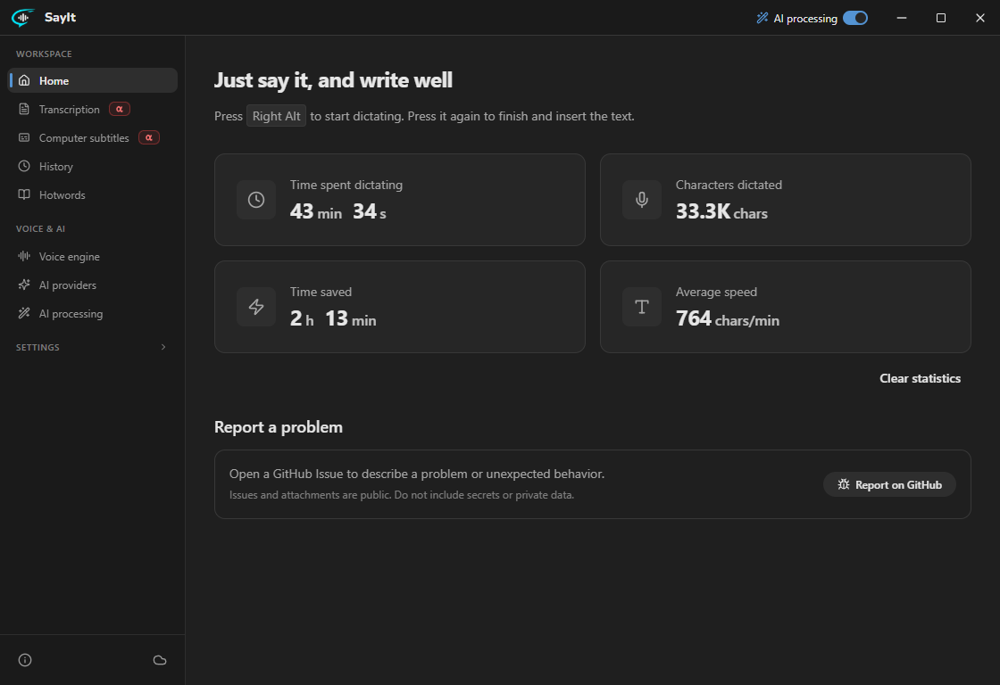
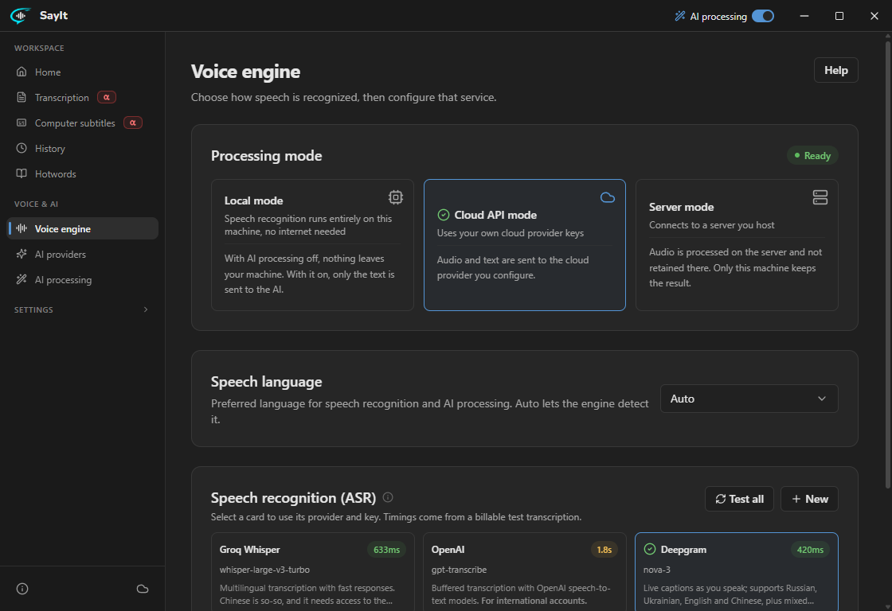
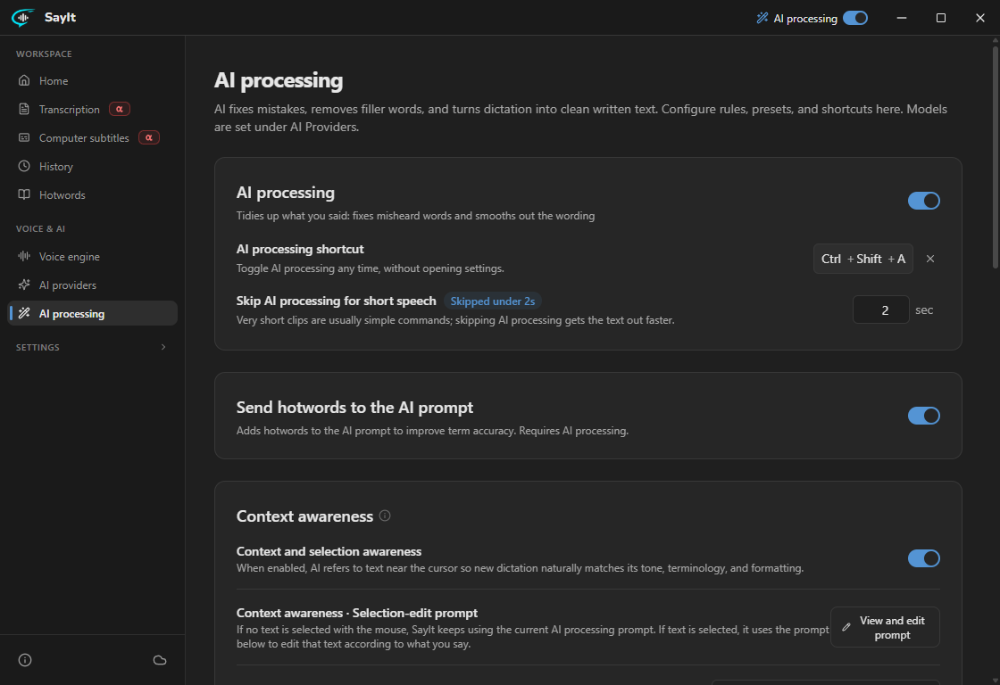
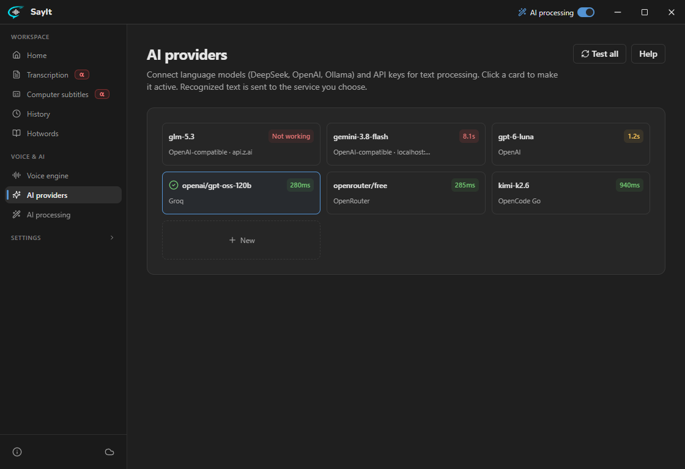
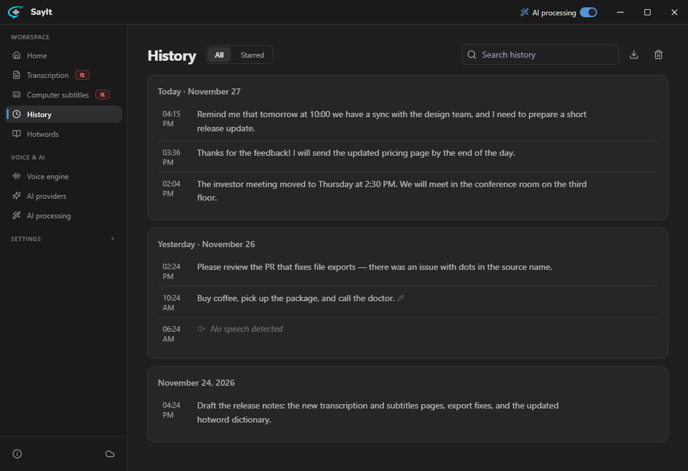
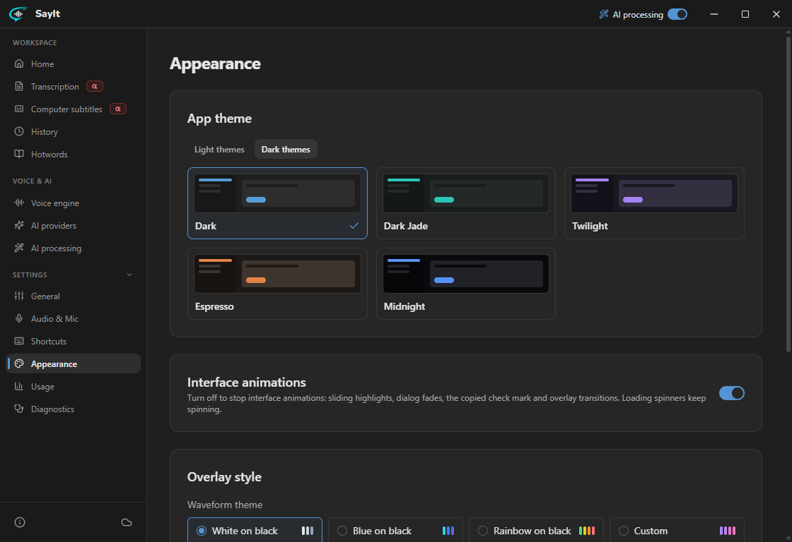

<div align="center">

[Українська](README.md) · **English**


# SayIt

**Just say it, and write well**

Open-source voice typing for Windows. Press a shortcut and speak—SayIt transcribes, cleans up, and inserts polished text wherever your cursor is.

[](./LICENSE)
[](https://github.com/catgirl3d/SayIt/releases/latest)
[](https://github.com/catgirl3d/SayIt/releases/latest)
[](CHANGELOG.md)

**[Download for Windows](https://github.com/catgirl3d/SayIt/releases/latest)**

</div>

**English, Ukrainian, Russian, and Chinese dictation:** built-in AI processing prompts are available in English and Ukrainian. Choose their instruction language separately in AI settings; on a fresh setup it starts out matching the UI language and changes only when you change it. Set the ASR recognition language independently and use a model that supports the language you speak.

## Why SayIt?

Typing is often the slowest part of working with AI. SayIt turns speech into text you can use immediately, while keeping the important choices in your hands:

- **Voice typing anywhere** — dictate into editors, chat apps, browsers, and other Windows software.
- **Live computer subtitles & translation (alpha)** — translate spoken audio from videos, calls (Zoom, Discord), and any app via native Windows WASAPI loopback, with no extra drivers needed. Includes a click-through overlay, dual-subtitle display (original speech alongside translation), and independent language controls.
  - Captions appear after each short speech fragment is recognized and translated, so they lag behind the video.
  - Live recognition of computer audio requires an active Deepgram profile in Cloud API mode. It streams audio continuously, silence and background sound included, so it may cost more; other engines transcribe the audio in segments.
- **Editable AI processing** — remove filler words, repair recognition errors, format ideas, or keep a faithful transcript. Every prompt is yours to change.
- **Context-aware writing** (off by default) — reads the text around your cursor so new dictation matches its tone and terminology. Select text first and your speech becomes an editing instruction—translate, tighten, rewrite, or ask a question—replacing the selection directly. Password fields are skipped. Selection edits use your current AI model by default; choose a separate saved model in Settings → AI processing → Context awareness.
- **Flexible speech recognition** — use a cloud ASR provider, run a local GGUF model on your own GPU, or connect to a SayIt backend you host or trust.
- **Audio and video file transcription (alpha)** — turn audio and video files into text with the local engine or a configured cloud profile. Bundled FFmpeg and FFprobe need no separate install, and the result is saved as TXT and Markdown next to the file or in a folder you choose. The transcript is not inserted into the active window, and file jobs stay out of History and usage statistics. While a local job runs, local dictation and computer subtitles are unavailable; cloud modes keep working.
- **English and Ukrainian interface** — the UI follows your system language and can be switched at any time.
- **Hotwords and per-app rules** — names and technical terms go to speech recognition on engines that accept them; for the rest, including Local mode, turn on "Send hotwords to the AI prompt" and AI processing fixes them instead. Per-app rules change AI processing automatically for different apps.
- **Overlay feedback** — a small waveform overlay shows recording state and elapsed time, with optional live captions while you speak, in Cloud API mode with a streaming Doubao, Qwen, or Deepgram model.
- **Clean recordings** — microphone boost (manual or automatic) for quiet speech, and optional muting of system audio while you record so your speakers don't bleed into the mic.
- **Transparent data flow** — the app shows which mode is active and where audio and text are processed.
- **Local history and diagnostics** — review recordings, re-transcribe them, export your history to JSON, and create a support bundle for a GitHub issue. The bundle is built locally, never uploaded automatically, and contains no raw logs, transcripts, or screenshots.
- **Backup and migration** — export and import your settings in full or just your hotwords, text replacements, or AI presets; move all data, including history and recordings, to another PC; and back up to your own WebDAV server on a schedule, with restore from it.
- **Usage statistics** — charts of your successful dictations on the Usage page, independent of history saving. The log records each dictation's character count, duration, app, work mode, and prompt preset, but no text, audio, or window titles. It also builds a personalization profile that helps AI processing adapt to the apps you dictate in most; clearing statistics resets it too.

## Choose how it runs

| Mode | Best for | Data flow |
| --- | --- | --- |
| **Local mode** | Privacy and offline use | Speech recognition runs on your PC. Data leaves it only through what you turn on: AI processing, subtitle translation, or a cloud profile for file transcription. |
| **Cloud API mode** | The best balance for personal use | Your PC talks directly to the ASR and AI providers you configure. No SayIt server is involved. |
| **Server mode** | Teams and managed deployments | Audio is processed by a SayIt backend you run or trust. |

Supported models and providers:

- **Local models** — 15 GGUF model variants, with GPU acceleration when available, that you download and delete right in the app: Parakeet Unified EN, Parakeet TDT v3 and 1.1B, SenseVoice Small, Fun-ASR Nano and MLT Nano, Nemotron 3.5 ASR (36 languages), GigaAM v3 (RNN-T and CTC), Qwen3-ASR 0.6B and two 1.7B quantizations, and Whisper Small, Large v3, and Large v3 Turbo.
- **Cloud speech recognition** — Doubao, Qwen (several models, including Omni), Xiaomi MiMo, Groq Whisper, Deepgram, OpenAI, Gemini, OpenRouter, and custom OpenAI-compatible services that support audio transcription.
- **AI processing** — DeepSeek, Qwen, Doubao, Xiaomi MiMo, Groq, OpenCode Go, OpenRouter, OpenAI, Ollama, and OpenAI-compatible chat APIs.

## A closer look

<div align="center">



*Home — dictation stats, the active shortcut, and a GitHub issue link for feedback.*

<br>



*Voice engine — choose Local, Cloud API, or Server mode, pick the speech language, and configure an ASR provider; per-provider latency is measured right on the card.*

<br>



*AI processing — toggle it on, bind a hotkey, pass dictionary terms into the prompt, and enable context awareness; built-in presets and per-app rules follow below.*

<br>



*AI providers — bring your own keys, add any OpenAI-compatible endpoint, and test round-trip latency on every card.*

<br>



*History — a searchable local archive grouped by day. Expand a record to see the raw ASR text, timings, audio playback, and re-transcribe.*

<br>



*Appearance — light and dark themes, interface animations, waveform styles including your own colors, overlay width, and elapsed-time display, plus live captions and an interactive overlay preview.*

</div>

## Get started

1. Download the latest [Windows installer](https://github.com/catgirl3d/SayIt/releases/latest).
2. Open SayIt and choose a voice engine — Local (download a model), Cloud API (your own key), or Server mode. The first-run guide helps you set it up.
3. Press the configured shortcut in any app and speak. By default you press once to start and again to finish; hold-to-talk is available too, under a separate shortcut.

Cloud provider keys go into the in-app settings, with a link to each provider's console beside its key field.

SayIt checks for updates at startup and every six hours (you can turn this off in General settings) but installs a new version only when you press "Download and install" on the About page. An interrupted download resumes where it stopped until you restart SayIt, and the About page also shows release notes, including those of earlier versions.

## Self-hosting

The backend combines FastAPI, WebSocket streaming, a choice of ASR engines (Qwen3-ASR by default, FireRedASR2, or Sber GigaAM), and optional AI processing through OpenAI, Azure OpenAI, Groq, or Ollama. Docker Compose is the recommended deployment path.

```bash
git clone https://github.com/catgirl3d/SayIt.git
cd SayIt/server
cp .env.example .env
# Add your provider keys to .env
docker compose up -d --build
```

By default the container serves HTTPS on port 8443 with a self-signed certificate that the desktop app does not accept. For the desktop app, set `SAYIT_TLS_ENABLED=false` in `.env` and connect to `http://<server-ip>:8000` on a network you trust, or use a certificate that Windows trusts.

See the [server guide](server/README.md) for configuration (including `config.yaml` overrides), deployment, security, and API details. To run the server on Windows without Docker and connect the desktop app to it, see the [Windows server guide](docs/SERVER_GUIDE.md).

## Development

### Desktop client

```bash
cd client
npm install
npm run tauri dev
```

Requirements: Node.js 20.19+, 22.13+, or 24+ (CI uses Node 24), Rust 1.97.1 (pinned in `rust-toolchain.toml`), CMake 3.20+, and the Vulkan SDK. The first native build compiles the C++ speech engine and may take around 20 minutes; later builds use the cache.

On non-English Windows installations, set `CL=/utf-8` before building so MSVC reads UTF-8 source files correctly.

### Server

On Linux or WSL2:

```bash
cd server
python3 -m venv .venv
source .venv/bin/activate
pip install -r backend/requirements.txt
cd backend
uvicorn app.main:app --port 8000 --no-proxy-headers
```

Requirements: Python 3.10+ and, for GPU inference, an NVIDIA GPU with CUDA.

Qwen3-ASR depends on vLLM, which does not run natively on Windows, so use Docker or WSL2 there. A GigaAM-only backend runs natively on Windows; the [Windows server guide](docs/SERVER_GUIDE.md) walks through it step by step, including connecting the desktop app.

## About

This version of SayIt is based on [crosswk/SayIt](https://github.com/crosswk/SayIt) and is developed independently.

## Project layout

```text
SayIt/
├── client/       # Tauri + React desktop client
├── server/       # FastAPI backend, gateway, web demo, and deployment files
├── docs/         # User guides and images
└── LICENSE       # AGPL-3.0 license
```
