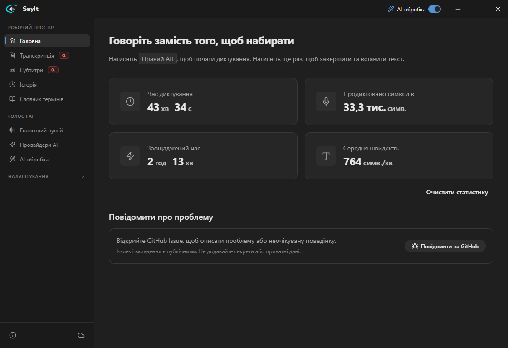
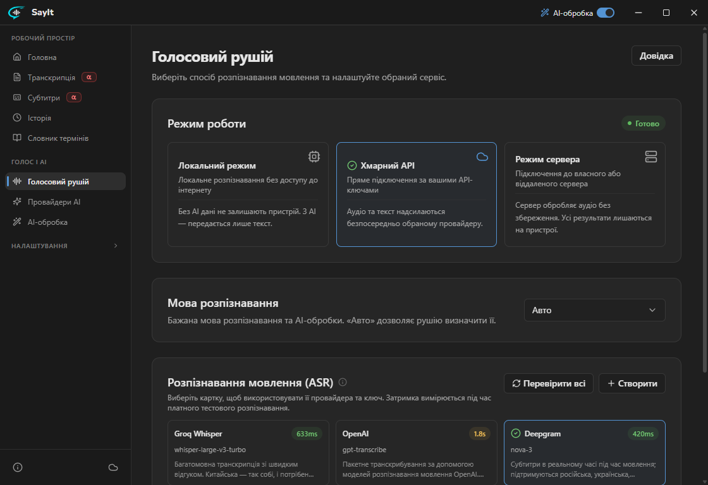
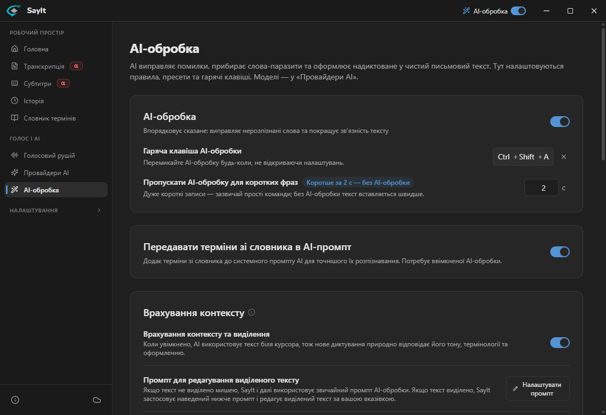
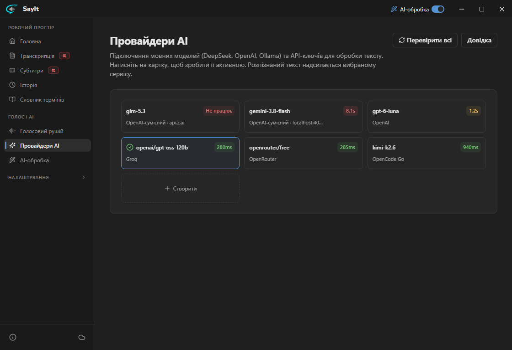
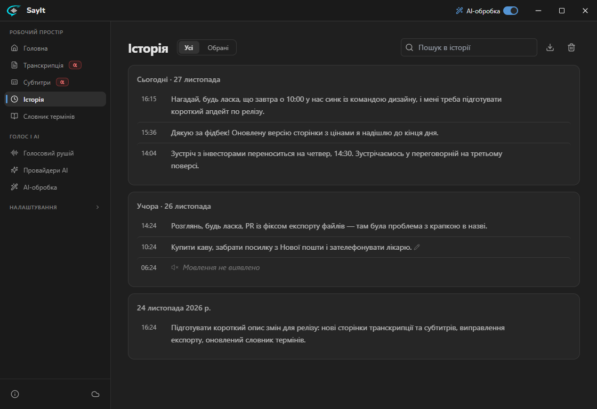
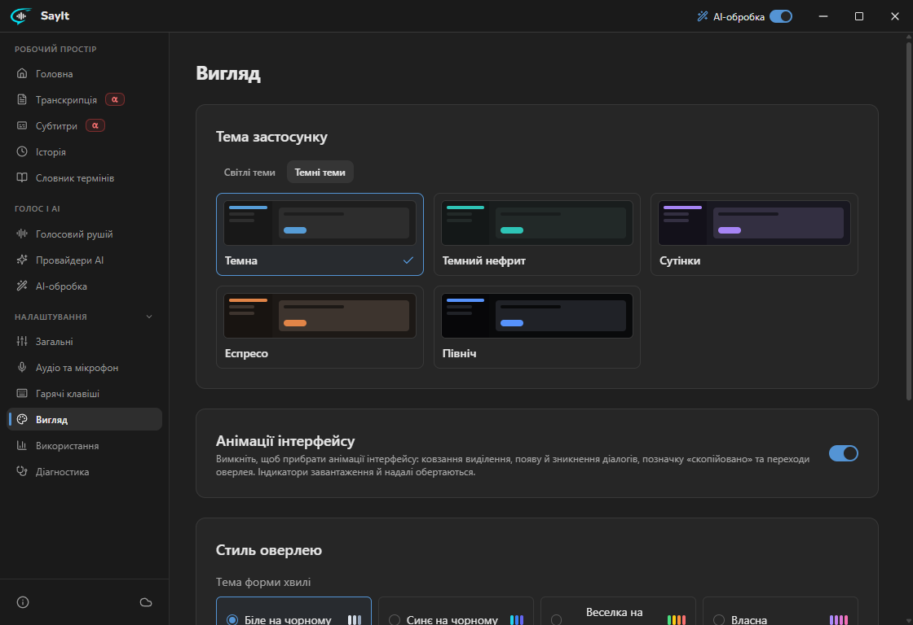

<div align="center">

**Українська** · [English](README.en.md)


# SayIt

Голосове введення з відкритим кодом для Windows. Натисніть гарячу клавішу та говоріть — SayIt розпізнає мовлення, очищує та редагує текст за допомогою AI і вставляє готовий текст прямо туди, де стоїть курсор.

[](./LICENSE)
[](https://github.com/catgirl3d/SayIt/releases/latest)
[](https://github.com/catgirl3d/SayIt/releases/latest)

**[Завантажити для Windows](https://github.com/catgirl3d/SayIt/releases/latest)**

</div>

## Особливості форку

Цей проєкт — підтримуваний форк [crosswk/SayIt](https://github.com/crosswk/SayIt). Завантажити інсталятор для Windows можна в розділі [Releases](https://github.com/catgirl3d/SayIt/releases/latest), а повний перелік змін та покращень — у [журналі оновлень](CHANGELOG.md); український переклад — [CHANGELOG.uk.md](CHANGELOG.uk.md).

**Мови диктування:** SayIt підтримує англійську, українську, російську та китайську. Вбудовані промпти для AI-обробки доступні англійською та українською; мову промптів можна вибрати в налаштуваннях AI. Під час першого запуску мова промптів береться з мови інтерфейсу, а далі змінюється лише вручну. Мову розпізнавання (ASR) можна вибрати окремо — достатньо обрати модель, що підтримує потрібну мову.

## Чому SayIt?

Набір тексту на клавіатурі часто залишається найповільнішим етапом взаємодії з комп'ютером та AI. SayIt перетворює мовлення на готовий текст і водночас залишає вам повний контроль над ключовими налаштуваннями:

- **Голосове введення всюди** — диктуйте в текстових редакторах, месенджерах, браузерах і будь-яких інших застосунках для Windows.
- **Субтитри комп'ютера з живим перекладом (alpha)** — вмикайте субтитри та переклад для відео, дзвінків (Zoom, Discord) і будь-яких застосунків завдяки нативному захопленню звуку Windows (WASAPI loopback) без додаткових драйверів чи програм. Підтримуються оверлей поверх усіх вікон, крізь який проходять кліки, режим подвійних субтитрів (оригінал і переклад) та незалежне налаштування мов.
  - Субтитри з'являються після розпізнавання й перекладу кожного короткого фрагмента мовлення, тому відстають від відео.
  - Потокове розпізнавання системного звуку доступне лише з активним профілем Deepgram у режимі Cloud API. Воно безперервно надсилає звук разом із тишею та фоном, тому може коштувати дорожче; інші рушії розпізнають мовлення фрагментами.
- **Гнучка AI-обробка** — прибирайте слова-паразити, виправляйте огріхи розпізнавання, структуруйте думки або зберігайте дослівну транскрипцію. Кожен системний промпт можна адаптувати під себе.
- **Контекстне введення** (за замовчуванням вимкнено) — зчитує текст навколо курсора, щоб нові речення відповідали тону та термінології вашого документа. Якщо перед диктуванням виділити фрагмент тексту, сказане можна використати як інструкцію: перекласти, скоротити, переписати або підготувати відповідь. Результат автоматично замінить виділений фрагмент. Текст із полів паролів не зчитується. Типово редагування виділеного тексту використовує поточну AI-модель; окрему збережену модель можна вибрати в налаштуваннях → «AI-обробка» → «Врахування контексту».
- **Гнучке розпізнавання мовлення** — підключайте хмарні ASR-сервіси, запускайте локальні GGUF-моделі на своєму GPU або під'єднуйтеся до бекенду SayIt, який запускаєте самі чи якому довіряєте.
- **Транскрипція файлів і відео (alpha)** — перетворюйте аудіо- та відеофайли на текст локальним рушієм або через налаштований хмарний профіль. Вбудовані FFmpeg і FFprobe працюють без окремого встановлення, а результат зберігається як TXT і Markdown поруч із файлом або в обраній папці. Транскрипт не вставляється в активне вікно, а завдання з файлами не потрапляють до історії та статистики. Поки триває локальне завдання, локальне диктування й субтитри недоступні; хмарні режими працюють.
- **Інтерфейс українською та англійською** — застосунок автоматично використовує мову системи, мову інтерфейсу можна будь-коли змінити в налаштуваннях.
- **Словник термінів (hotwords) і правила для застосунків** — терміни передаються в розпізнавання мовлення, якщо рушій це підтримує; для решти, зокрема локального режиму, увімкніть «Передавати терміни зі словника в AI-промпт», і їх виправить AI-обробка. Правила для застосунків автоматично змінюють AI-обробку залежно від активного застосунку.
- **Зручний оверлей** — компактний плаваючий віджет з індикатором рівня звуку показує стан запису й таймер, а також може виводити субтитри наживо під час мовлення — у режимі Cloud API з потоковими моделями Doubao, Qwen або Deepgram.
- **Чистий запис** — підсилення мікрофона (вручну або автоматично) для тихого мовлення та, за бажанням, вимкнення системного звуку на час запису, щоб звук із динаміків не потрапляв у мікрофон.
- **Прозорість обробки даних** — застосунок чітко показує активний режим і те, куди саме спрямовуються аудіо та текст.
- **Локальна історія та діагностика** — переглядайте записи, повторно запускайте розпізнавання, експортуйте історію в JSON та створюйте пакет підтримки для GitHub Issue. Пакет формується локально, нікуди не надсилається автоматично й не містить необроблених журналів, розпізнаного тексту чи знімків екрана.
- **Резервні копії та перенесення** — експортуйте й імпортуйте налаштування повністю або лише словник термінів, заміни тексту чи AI-пресети; переносьте всі дані разом з історією та записами на інший ПК; налаштуйте автоматичне резервне копіювання на власний WebDAV-сервер за розкладом і відновлення з нього.
- **Статистика використання** — графіки успішних диктувань у розділі «Використання», незалежно від збереження історії. Журнал фіксує для кожного диктування кількість символів, тривалість, застосунок, режим роботи та пресет промпту, але не текст, аудіо чи заголовки вікон. На його основі будується профіль персоналізації, що допомагає AI-обробці підлаштовуватися під застосунки, у яких ви диктуєте найчастіше; очищення статистики скидає й його.

## Режими роботи

| Режим | Для чого підходить | Обробка даних |
| --- | --- | --- |
| **Локальний режим** | Приватність і робота без інтернету | Розпізнавання відбувається на вашому ПК. Дані залишають його лише через те, що ви самі ввімкнете: AI-обробку, переклад субтитрів або хмарний профіль для транскрипції файлів. |
| **Хмарний API** | Швидке розпізнавання без локальних моделей | Застосунок напряму звертається до вибраних провайдерів ASR та AI без проміжних серверів SayIt. |
| **Режим сервера** | Робота в команді або керована інфраструктура | Аудіо обробляється на бекенді SayIt, який ви запускаєте або якому довіряєте. |

Підтримувані моделі та провайдери:

- **Локальні моделі** — 15 оптимізованих GGUF-моделей із підтримкою GPU-прискорення, які можна завантажити й видалити прямо в застосунку: Parakeet Unified EN, Parakeet TDT v3 та 1.1B, SenseVoice Small, Fun-ASR Nano та MLT Nano, Nemotron 3.5 ASR (36 мов), GigaAM v3 (RNN-T і CTC), Qwen3-ASR 0.6B та дві квантовані версії 1.7B, а також Whisper Small, Large v3 і Large v3 Turbo.
- **Хмарне розпізнавання** — Doubao, Qwen (кілька моделей, зокрема Omni), Xiaomi MiMo, Groq Whisper, Deepgram, OpenAI, Gemini, OpenRouter та власні OpenAI-сумісні сервіси з підтримкою транскрипції аудіо.
- **AI-обробка** — DeepSeek, Qwen, Doubao, Xiaomi MiMo, Groq, OpenCode Go, OpenRouter, OpenAI, Ollama та OpenAI-сумісні API чату.

## Огляд інтерфейсу

<div align="center">



*Головний екран — статистика диктування, активна комбінація клавіш і посилання на GitHub для зворотного зв'язку.*

<br>



*Голосовий рушій — вибір локального, хмарного або серверного режиму, мови розпізнавання та ASR-провайдера; затримка кожного провайдера вимірюється прямо на картці.*

<br>



*AI-обробка — вмикання, гаряча клавіша, передача термінів зі словника та врахування контексту; нижче — вбудовані пресети й правила для окремих застосунків.*

<br>



*AI-провайдери — додавання власних API-ключів, підключення будь-яких OpenAI-сумісних сервісів та вимірювання часу відгуку прямо в картці моделі.*

<br>



*Історія — локальний архів із пошуком і фільтрами, згрупований за днями. Кожен запис можна розгорнути для перегляду початкового тексту розпізнавання, часових міток, прослуховування аудіо чи повторного розпізнавання.*

<br>



*Зовнішній вигляд — світлі й темні теми, анімації інтерфейсу, стилі хвилі з власними кольорами, ширина оверлею та показ витраченого часу; субтитри наживо й інтерактивний попередній перегляд.*

</div>

## Початок роботи

1. Завантажте останню версію [інсталятора для Windows](https://github.com/catgirl3d/SayIt/releases/latest).
2. Відкрийте SayIt і виберіть голосовий рушій — локальний режим (завантажте модель), хмарний API (власний ключ) або режим сервера. Майстер першого запуску допоможе з налаштуванням.
3. Натисніть гарячу клавішу в будь-якому застосунку та почніть говорити. За замовчуванням перше натискання вмикає запис, а повторне — зупиняє його; також можна налаштувати режим диктування з утриманням клавіші.

API-ключі хмарних провайдерів вводяться в налаштуваннях застосунку, а посилання на консоль кожного сервісу розташоване поруч із полем його ключа.

SayIt перевіряє оновлення під час запуску та щошість годин (це можна вимкнути в розділі «Загальні»), але встановлює нову версію лише після натискання «Завантажити та встановити» в розділі «Про застосунок». Перерване завантаження до перезапуску SayIt продовжується з місця зупинки, а там же можна переглянути примітки до релізів, включно з попередніми версіями.

## Режим сервера (Self-hosting)

Бекенд поєднує FastAPI, потокове передавання через WebSocket, вибір ASR-рушія (типово Qwen3-ASR, а також FireRedASR2 чи Sber GigaAM) та необов'язкову AI-обробку через OpenAI, Azure OpenAI, Groq або Ollama. Рекомендований спосіб розгортання — Docker Compose.

```bash
git clone https://github.com/catgirl3d/SayIt.git
cd SayIt/server
cp .env.example .env
# Вкажіть ключі провайдерів у .env
docker compose up -d --build
```

За замовчуванням контейнер працює по HTTPS на порту 8443 із самопідписаним сертифікатом, який десктопний застосунок не приймає. Для застосунку вкажіть у `.env` `SAYIT_TLS_ENABLED=false` і підключайтеся до `http://<IP-сервера>:8000` у мережі, якій довіряєте, або використайте сертифікат, якому довіряє Windows.

Докладніше про налаштування (зокрема перевизначення через `config.yaml`), розгортання, безпеку та API читайте в [посібнику з налаштування сервера](server/README.md). Як запустити сервер у Windows без Docker і підключити до нього десктопний застосунок, описано в [посібнику з сервера для Windows](docs/SERVER_GUIDE.md).

## Розробка

### Десктопний клієнт

```bash
cd client
npm install
npm run tauri dev
```

Вимоги: Node.js 20.19+, 22.13+ або 24+ (у CI використовується Node 24), Rust 1.97.1 (версія закріплена в `rust-toolchain.toml`), CMake 3.20+ та Vulkan SDK. Перша компіляція нативного рушія C++ займає близько 20 хвилин, а завдяки кешу наступні збірки проходять значно швидше.

Якщо у вас встановлена не англомовна версія Windows, перед запуском збірки встановіть змінну середовища `CL=/utf-8`, щоб компілятор MSVC коректно зчитував файли вихідного коду в кодуванні UTF-8.

### Сервер

У Linux або WSL2:

```bash
cd server
python3 -m venv .venv
source .venv/bin/activate
pip install -r backend/requirements.txt
cd backend
uvicorn app.main:app --port 8000 --no-proxy-headers
```

Вимоги: Python 3.10+ та відеокарта NVIDIA з CUDA для запуску моделей на GPU.

Qwen3-ASR залежить від vLLM, який не працює у Windows нативно, тому там використовуйте Docker або WSL2. Бекенд лише з GigaAM запускається у Windows нативно — покроково це описано в [посібнику з сервера для Windows](docs/SERVER_GUIDE.md), разом із підключенням десктопного застосунку.

## Структура проєкту

```text
SayIt/
├── client/       # Десктопний клієнт на Tauri + React
├── server/       # Бекенд на FastAPI, шлюз, веб-демо та файли розгортання
├── docs/         # Посібники користувача та зображення
└── LICENSE       # Ліцензія AGPL-3.0
```
